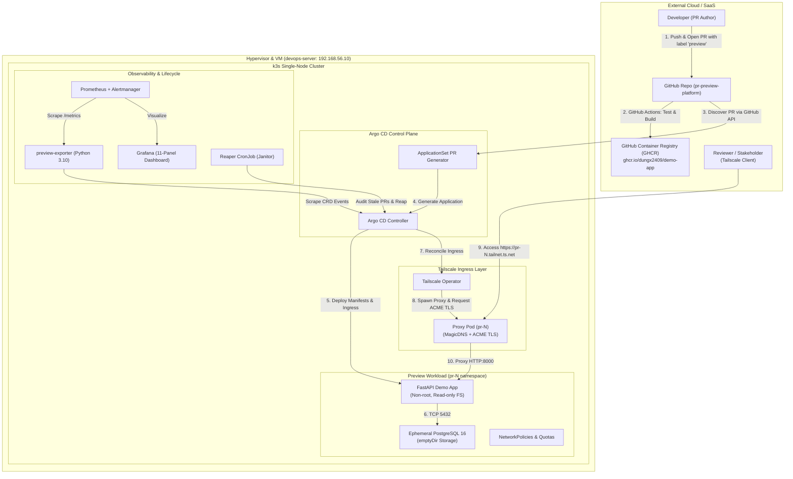

# PR Preview Platform

[](https://github.com/Dungx2409/pr-preview-platform/actions/workflows/ci.yml)
[](LICENSE)
[](https://k3s.io)
[](https://argoproj.github.io/cd/)
[](https://tailscale.com)
[](https://python.org)

A zero-cost, self-hosted, pull-based GitOps platform that automatically provisions isolated, HTTPS-secured preview environments for every labeled Pull Request on a local k3s cluster. Environments are securely shared with teammates over Tailscale WireGuard mesh with automated dual-layer teardown and zero resource leaks.

---

## 1. The Problem & Why This Exists

### The Dilemma of Preview Environments
- **SaaS Preview Platforms (Vercel, Netlify):** Excellent for Jamstack and static frontends, but difficult or costly for full-stack applications requiring dedicated backend services and live database instances.
- **Cloud Kubernetes (EKS, GKE):** Provisioning dynamic preview clusters in the cloud typically costs **$70–$150+/month** just to maintain control plane availability, worker nodes, and public load balancers.
- **Local Docker Compose:** Requires every reviewer to clone the repository, install local toolchains, build images, and manage database state on their own machine.

### The Solution
A **$0/month self-hosted GitOps engine** running on a local single-node k3s cluster inside a VirtualBox Linux VM:
- **Pull-Based GitOps:** CI builds containers and pushes them to GHCR. The in-cluster Argo CD engine detects the PR, reconciles the desired state, and pulls manifests. **CI holds zero cluster credentials.**
- **Private-by-Default Zero-Trust Ingress:** Workloads are completely shielded behind NAT. Tailscale Kubernetes Operator dynamically provisions proxy pods with valid Let's Encrypt TLS certificates (`https://pr-<N>.<tailnet>.ts.net`) accessible only to authenticated team reviewers.
- **Zero Resource Leaks:** Automated event-driven GitHub Actions combined with an in-cluster autonomous Reaper CronJob guarantees complete teardown down to the last byte within seconds of PR closure.

---

## 2. Architecture & Request Flow



For full details on topology, sequence diagrams, and lifecycle flows, see [`docs/architecture.md`](docs/architecture.md).

---

## 3. Empirically Measured Results

Every metric below was measured against the live environment under real-world testing (see [`DEVLOG.md`](DEVLOG.md)):

| Metric / Objective | Target | Measured Result | Verification Method |
|---|---|---|---|
| **Time-to-Ready (PR Labeled → URL Ready)** | p50 ≤ 5 min | **102 s** (1m 42s) | Stopwatch from PR #26 opened to HTTP 200 on Tailnet (T-4.4) |
| **Teardown Time (PR Closed → Resources Reaped)**| ≤ 3 min | **6–7 s** (cluster) / **~25 s** (full CI) | Automated 20 open/close cycles via `scripts/test-20-cycles.sh` (T-4.5) |
| **Cluster Resource Leaks after 20 Cycles** | 0 leaks | **0 leaks** | Pods, Ingresses, Secrets, Namespaces cleanly destroyed (T-4.6) |
| **Memory Footprint per Active Preview** | ≤ 200 MiB | **~86.5 MiB** total | Proxy: ~16.5 MiB · App: ~40 MiB · Postgres: ~30 MiB (T-2.0, T-3.1) |
| **VM Free Memory Headroom (Full Stack)** | ≥ 20 % free | **77.7 % free** (5.7 / 7.4 GB available) | `free -m` on VM running k3s, Argo CD, Monitoring & Shared (T-2.3) |
| **Disaster Recovery Rebuild Time** | ≤ 30 min | **17 min** (cached) / **39m 50s** (cold) | End-to-end rebuild from clean OS snapshot using `scripts/dr-restore.sh` (T-7.1) |

---

## 4. Centralized Project Configuration (`values.yaml`)

The platform avoids hardcoded project parameters across manifests, Helm templates, and ApplicationSets by centralizing configuration into a single root [`values.yaml`](values.yaml):

```yaml
# Git repository configuration
repo:
  url: "https://github.com/Dungx2409/pr-preview-platform.git"
  label: "preview"

# Application container and service settings
app:
  name: "demo-app"
  image: "ghcr.io/dungx2409/demo-app"
  port: 8000
  healthcheck: "/healthz"

# Preview environment namespace conventions
namespace:
  prefix: "preview"   # Change when running multiple projects in parallel
```

### Switching Projects: "Đổi dự án = sửa `values.yaml`, make sync-config, Argo sync"

To adapt this preview platform to any other repository/project:
1. **Edit [`values.yaml`](values.yaml):** Set your target Git repository URL (`repo.url`), container image path, port, and healthcheck.
2. **Auto-Sync Manifests:** Run `make sync-config` (or commit; `make lint` verifies sync automatically). This propagates `owner`, `repo`, and whitelist rules to `applicationset-previews.yaml` and `project-previews.yaml` with zero manual YAML edits.
3. **Commit & Push:** Commit and push to git (`git commit -am "chore: adapt platform to new project" && git push`).
4. **Argo CD Automatic Sync:** Argo CD immediately detects the changes, binds to the new repository, and starts creating previews for the new project!

> [!TIP]
> **Multi-Project Parallelism:** When running previews for multiple distinct microservices or projects on the same cluster, change `namespace.prefix` (e.g. `billing`, `auth`, `preview`) to isolate namespaces and prevent resource collisions.

---

## 4. Key Platform Features

### 🔒 Zero-Trust Private Ingress
- Exposes workloads exclusively on private Tailscale CGNAT IPs (`100.64.0.0/10`).
- No ports opened on physical routers or host firewalls.
- Automatic Let's Encrypt certificates issued via DNS-01 ACME challenges through Tailscale MagicDNS.
- Injects authenticated user headers (`Tailscale-User-Login`, `Tailscale-User-Name`) into backend requests.

### ☸️ Pull-Based GitOps Orchestration
- Powered by **Argo CD ApplicationSet** using the GitHub Pull Request Generator.
- Continuous reconciliation: automatically updates preview images on new git pushes and deletes applications when PRs close.
- Strict AppProject boundaries: restricts generated preview applications to `pr-*` namespaces and prohibits cluster-scoped resource creation.

### 🛡️ Defense-in-Depth Container Hardening
- Enforces Kubernetes **Pod Security Standards (PSS) Baseline**.
- Non-root execution (`runAsUser: 10001`, `runAsNonRoot: true`).
- Read-only root filesystems (`readOnlyRootFilesystem: true`).
- All Linux capabilities dropped (`capabilities.drop: ["ALL"]`).
- Default-deny NetworkPolicies blocking metadata server (`169.254.169.254/32`) and cross-namespace traversal.
- Namespace `ResourceQuota` and `LimitRange` guardrails preventing CPU/memory exhaustion.

### 🧹 Dual-Layer Teardown & Janitor Engine
- **Fast-Path:** GitHub Actions workflow triggered on `pull_request: [closed]` immediately removes GHCR images and untags the PR.
- **Slow-Path Safety Net:** In-cluster Python `Reaper` CronJob runs every 15 minutes, purging orphaned namespaces, expired previews exceeding TTL (24 hours), or dangling Tailscale proxy pods.

### 📊 Comprehensive Observability Stack
- **Prometheus & Grafana:** Deployed via a customized, lean `kube-prometheus-stack` (v92.11.0).
- **Custom Exporter (`preview-exporter`):** Lightweight Python daemon tracking active previews, reaped count, and exact time-to-ready duration.
- **Pre-configured Dashboard:** 11-panel Grafana dashboard visualizing live preview inventory, time-to-ready quantiles (p50/p95), and node headroom.
- **Alert Rules:** Alerting on low VM memory headroom (< 20%), reaper activations, and Tailscale proxy readiness.

---

## 5. Repository Structure

```
.
├── .github/workflows/          # CI lint/test, preview build, and preview teardown workflows
├── ansible/                    # Infrastructure-as-Code for node provisioning
│   ├── inventory/              # Host inventory definitions
│   └── roles/k3s/              # Automated k3s single-node cluster installation role
├── charts/app/                 # Production-grade Helm chart for demo-app + ephemeral postgres
│   └── templates/              # NetworkPolicy, Quotas, Limits, Ingress, Deployment manifests
├── demo-app/                   # Full-stack FastAPI demo application with health probes & DB migrations
├── docs/                       # Comprehensive platform documentation
│   ├── architecture.md         # System topology, sequence diagrams, and component models
│   ├── decisions.md            # Architecture Decision Records (ADRs)
│   ├── runbook.md              # Day-2 operations, troubleshooting, and Disaster Recovery SOP
│   ├── security.md             # Security matrix, threat model, and verification results
│   └── versions.md             # Pinned software, chart, and tool versions
├── exporter/                   # Python preview-exporter daemon and ServiceMonitor definitions
├── platform/                   # Platform configurations
│   ├── argocd/                 # Argo CD ApplicationSet, AppProject, and Applications
│   ├── bootstrap/              # Bootstrap shell scripts for Tailscale, Argo CD, and Monitoring
│   ├── monitoring/             # Grafana dashboards, alert rules, and exporter manifests
│   ├── reaper/                 # In-cluster Reaper CronJob, RBAC, and ConfigMap
│   └── tailscale/              # Tailscale Operator Helm values and ACL snippets
├── reaper/                     # Python source code and unit tests for the janitor daemon
└── scripts/                    # Automation scripts (stress testing, security audit, DR restore)
```

---

## 6. Quickstart & Local Setup

### Prerequisites
- Host machine running Linux or macOS with **VirtualBox 7.0+**
- Host tools installed: `ansible-playbook`, `kubectl`, `helm`, `git`
- Tailscale account with an OAuth Client (`devices:write`, `auth:read`)

### Step 1: Provision the VM & k3s Cluster
```bash
# 1. Provision the local VM and install k3s via Ansible
ansible-playbook -i ansible/inventory/local.ini ansible/site.yml

# 2. Set KUBECONFIG to the generated host config
export KUBECONFIG="${HOME}/.kube/pr-preview.yaml"
kubectl get nodes -o wide
```

### Step 2: Configure Platform Secrets
Create the required out-of-band secrets (stored outside the repository):
```bash
mkdir -p ~/.config/pr-preview/dr-secrets
chmod 700 ~/.config/pr-preview/dr-secrets

# 1. Tailscale Operator OAuth Secret
kubectl create namespace tailscale --dry-run=client -o yaml | kubectl apply -f -
kubectl create secret generic operator-oauth -n tailscale \
  --from-literal=client_id="<YOUR_CLIENT_ID>" \
  --from-literal=client_secret="<YOUR_CLIENT_SECRET>"

# 2. GitHub Access Token for Argo CD & Reaper
kubectl create namespace argocd --dry-run=client -o yaml | kubectl apply -f -
kubectl create secret generic github-token -n argocd \
  --from-literal=token="<YOUR_GITHUB_TOKEN>"

# 3. Master Postgres Secret for Shared Tier 1
kubectl create namespace shared --dry-run=client -o yaml | kubectl apply -f -
kubectl create secret generic shared-main-app-postgres -n shared \
  --from-literal=password="postgres-secret-password"
```

### Step 3: Bootstrap Platform Services
Bootstrap all in-cluster components with a single command:
```bash
make bootstrap-platform
# Or for end-to-end VM provisioning + cluster bootstrap:
make bootstrap
```

Alternatively, run each bootstrap script individually:
```bash
# Bootstrap Tailscale Operator
bash platform/bootstrap/install-tailscale.sh

# Bootstrap Argo CD & GitOps Engine
bash platform/bootstrap/install-argocd.sh
kubectl apply -f platform/argocd/project-previews.yaml
kubectl apply -f platform/argocd/application-shared.yaml
kubectl apply -f platform/argocd/applicationset-previews.yaml

# Bootstrap Monitoring & Exporter
bash platform/bootstrap/install-monitoring.sh
kubectl apply -f platform/reaper/rbac.yaml
kubectl apply -f platform/reaper/configmap.yaml
kubectl apply -f platform/reaper/cronjob.yaml
```

### Step 4: Verify Deployment
```bash
# Verify Tier 1 baseline app responds over Tailnet
curl -s -i https://shared.taildc1471.ts.net/readyz
# Expected: HTTP/2 200 {"status":"ready","db":"ok"}
```

---

## 7. Developer & Reviewer Workflow

```
1. Developer creates a branch and opens a Pull Request on GitHub.
2. Developer attaches the label 'preview' to the PR.
3. GitHub Actions builds the image and pushes to GHCR.
4. Argo CD detects the label and provisions 'pr-<N>' in the cluster.
5. Tailscale registers MagicDNS name 'https://pr-<N>.<tailnet>.ts.net' with valid HTTPS.
6. Reviewer clicks the preview link directly in the PR comment to test the live feature.
7. Closing or merging the PR instantly deletes the namespace and revokes the Tailscale node.
```

---

## 8. Verification & Quality Commands

| Command | Purpose |
|---|---|
| `make bootstrap` | End-to-end bootstrap: provision k3s via Ansible and bootstrap all platform services |
| `make bootstrap-platform` | Bootstrap in-cluster platform services only (Tailscale, Argo CD, Monitoring, Reaper) |
| `make sync-config` | Synchronize platform manifests with root `values.yaml` |
| `make lint` | Run all linters (`check-config`, `yamllint`, `ansible-lint`, `shellcheck`, `ruff`, `gitleaks`, `helm lint`, `trivy`) |
| `make test` | Run all 18 unit tests (FastAPI app, exporter, and reaper) |
| `make helm-template` | Render Helm chart with sample values and validate dry-run Kubernetes manifests |
| `make verify-security` | Run automated security audit against cluster (PSS, NetworkPolicy, DNS isolation) |
| `make verify-teardown` | Verify zero lingering preview namespaces or proxy pods remain in cluster |
| `make test-stress` | Run automated 20-cycle open/close stress test to verify zero leaks |

---

## 9. Limitations & Trade-Offs

To maintain architectural transparency, the platform intentionally makes specific trade-offs:

1. **Host Dependency ("Host PC Must Be On"):**
   - Because the platform runs on a local single-node VirtualBox VM to achieve **$0 cloud cost**, previews are accessible only while the host development machine is powered on and connected to the internet.
   - *Mitigation:* A systemd service or background daemon keeps the VM running headless. In production enterprise environments, the identical Ansible playbook deploys seamlessly to a 24/7 cloud VM (GCP Compute Engine e2-standard-2).
2. **Tailscale Quotas & Mesh Requirement:**
   - Reviewers must be connected to the organization's Tailnet to access preview URLs. Public internet visitors receive `NXDOMAIN`.
   - The Tailscale free plan limits ephemeral tagged devices to 3 active machines (and 100 total devices). For higher preview concurrency, a Tailscale Team plan or subnet router is used.
3. **Single-Node Availability:**
   - Single-node k3s lacks multi-AZ control plane quorum. Node failures require executing the automated disaster recovery restore script ([`scripts/dr-restore.sh`](scripts/dr-restore.sh)).
4. **Initial TLS Handshake Latency:**
   - The first request to a newly created preview hostname experiences a **~36–38 second delay** while Let's Encrypt completes the DNS-01 challenge through Tailscale's coordination server. Subsequent requests resolve in under 45 ms.

---

## 10. Documentation Index

- 📘 [System Architecture](docs/architecture.md) — Comprehensive component topology, networking model, and sequence diagrams.
- 🔐 [Security Matrix & Threat Model](docs/security.md) — Zero-trust access controls, container hardening, and empirical security test results.
- 📋 [Operations & Runbook](docs/runbook.md) — Standard Operating Procedures (SOP), troubleshooting guides, and Disaster Recovery protocol.
- ⚖️ [Architecture Decision Records (ADRs)](docs/decisions.md) — Technical evaluations, rejected alternatives, and trade-off rationales.
- 📌 [Pinned Component Versions](docs/versions.md) — Explicit versions for Kubernetes, Helm charts, Python packages, and linters.

---

## License

This project is open-source under the [MIT License](LICENSE).
