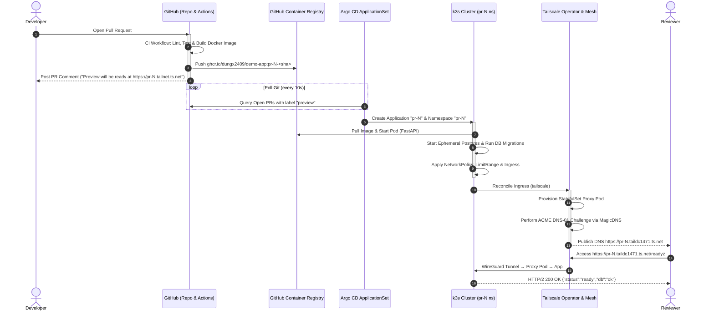
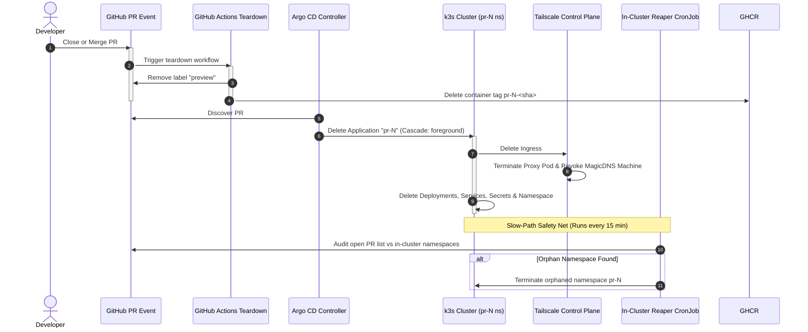
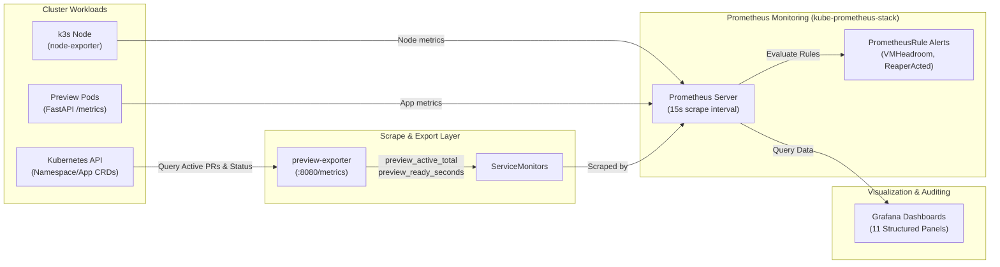

# System Architecture

This document describes the high-level architecture, component topology, networking model, and end-to-end workflows of the **PR Preview Platform** per SPEC v2.0 §2.

---

## 1. High-Level Architecture Topology

The platform operates as a self-hosted, pull-based GitOps system running on a local single-node **k3s** cluster inside an Ubuntu Server 24.04 virtual machine. External dependencies are strictly minimized to public GitHub (repository and container registry) and the Tailscale coordination server.

```mermaid
flowchart TB
    subgraph "Public Cloud / SaaS Layer"
        dev["Developer / PR Author"]
        gh["GitHub Repo (pr-preview-platform)"]
        ghcr["GitHub Container Registry (GHCR)\nghcr.io/dungx2409/demo-app"]
        ts_ctrl["Tailscale Coordination Server\n(MagicDNS & Control Plane)"]
        reviewer["Reviewer / Stakeholder\n(Tailscale Mesh Client)"]
    end

    subgraph "Local Hypervisor (VirtualBox)"
        subgraph "Host Machine (Linux)"
            ansible["Ansible Automation\n(Playbooks & Roles)"]
            vboxnet0["Host-Only Network Interface\n(192.168.56.0/24)"]
        end

        subgraph "Virtual Machine (devops-server: 192.168.56.10)"
            subgraph "k3s Single-Node Kubernetes (v1.36.5+k3s1)"
                subgraph "Namespace: kube-system"
                    flannel["Flannel CNI (vxlan)"]
                    coredns["CoreDNS"]
                    metrics["Metrics Server"]
                end

                subgraph "Namespace: tailscale"
                    ts_op["Tailscale Operator (v1.104.2)"]
                end

                subgraph "Namespace: argocd"
                    argo_ctrl["Argo CD Application Controller"]
                    argo_appset["Argo CD ApplicationSet Controller"]
                    argo_repo["Argo CD Repo Server"]
                    argo_server["Argo CD API/UI Server (ClusterIP)"]
                end

                subgraph "Namespace: monitoring"
                    prom["Prometheus (v3.10.0)"]
                    grafana["Grafana (v11.5.2)"]
                    exporter["Preview Exporter (Python 3.10)"]
                    sm["ServiceMonitors"]
                end

                subgraph "Namespace: reaper"
                    reaper_cron["Reaper CronJob (Python 3.10)\n(Every 15 mins)"]
                end

                subgraph "Namespace: shared (Tier 1 Baseline)"
                    shared_proxy["Tailscale Proxy Pod\n(shared-1.taildc1471.ts.net)"]
                    shared_app["Shared Main App (FastAPI)"]
                    shared_db["Shared Postgres (16-alpine)"]
                end

                subgraph "Namespace: pr-<N> (Tier 2 Ephemeral Previews)"
                    pr_proxy["Tailscale Proxy Pod\n(pr-N.taildc1471.ts.net)"]
                    pr_app["Preview App Pod (FastAPI)"]
                    pr_db["Ephemeral Postgres (16-alpine)"]
                end
            end
        end
    end

    %% Workflows
    dev -->|Git Push & Open PR| gh
    gh -->|GitHub Actions CI| ghcr
    gh -->|PR Polling (Token)| argo_appset
    argo_appset -->|Generate Application| argo_ctrl
    argo_ctrl -->|Pull Manifests & Deploy| pr_app
    argo_ctrl -->|Deploy Ingress| ts_op
    ts_op -->|Register Machine & ACME TLS| ts_ctrl
    ts_op -->|Spawn Ingress Proxy| pr_proxy
    reviewer -->|WireGuard HTTPS:443| pr_proxy
    pr_proxy -->|ClusterIP HTTP:8000| pr_app
    pr_app -->|TCP 5432| pr_db
    ansible -->|SSH :22 & k3s setup| vboxnet0
    vboxnet0 -->|Host-only Traffic| devops-server
    exporter -->|Scrape CRDs & Nodes| argo_ctrl
    prom -->|Scrape /metrics| exporter
    grafana -->|Visualize Dashboard| prom
    reaper_cron -->|Audit PR Status & Reap| argo_ctrl
```

---

## 2. Core Subsystems

### 2.1 GitOps Control Plane (Argo CD)
- **Pull-Based Synchronization:** Argo CD runs inside the cluster and continuously reconciles desired state stored in the Git repository (`charts/app/` and `platform/argocd/`) with the cluster's actual state.
- **ApplicationSet Pull Request Generator:** Uses the GitHub Pull Request Generator to discover open PRs targeting `main` that have the `preview` label.
- **Dynamic Parameter Injection:**
  ```yaml
  parameters:
    pr_number: "{{ number }}"
    head_sha: "{{ head_sha }}"
    branch_name: "{{ branch }}"
    image_tag: "pr-{{ number }}-{{ head_sha }}"
  ```
- **AppProject Isolation (`project-previews`):** Restricts generated applications to target exclusively `pr-*` and `shared` namespaces. Cluster-scoped resource creation is strictly forbidden (except `Namespace`), preventing privilege escalation.

### 2.2 Private Ingress & Zero-Trust Mesh (Tailscale Operator)
- **Zero Public Surface:** No public IPv4/IPv6, port-forwarding, or NAT punching on the host machine. Previews are exposed exclusively on private CGNAT overlay IPs (`100.64.0.0/10`).
- **Dedicated Proxy Architecture:** Each `Ingress` resource with `ingressClassName: tailscale` instructs the Tailscale Operator to provision a dedicated StatefulSet proxy pod in the target namespace.
- **Automatic Let's Encrypt TLS:** The operator coordinates with Tailscale MagicDNS and Let's Encrypt to complete DNS-01 ACME challenges and issue trusted, browser-valid certificates for `https://<hostname>.<tailnet>.ts.net`.
- **Identity-Aware Headers:** Tailscale proxies authenticate incoming requests using WireGuard keys and inject verified user headers:
  - `Tailscale-User-Login`: Reviewer email (e.g., `user@example.com`).
  - `Tailscale-User-Name`: Reviewer display name.

### 2.3 Workload Hardening & Tenant Isolation
Each preview namespace (`pr-<N>`) is sandboxed with defense-in-depth security:
1. **Pod Security Standards (PSS):** Namespace labeled `pod-security.kubernetes.io/enforce: baseline`.
2. **Container Security Context:**
   - Non-root user (`runAsUser: 10001`, `runAsNonRoot: true`).
   - Read-only root filesystem (`readOnlyRootFilesystem: true`).
   - Drop all Linux capabilities (`capabilities.drop: ["ALL"]`).
   - Explicitly disable privilege escalation (`allowPrivilegeEscalation: false`).
3. **Resource Boundaries:**
   - `LimitRange`: Enforces default CPU (100m) and memory (128Mi) requests and maximum limits (500m / 512Mi).
   - `ResourceQuota`: Restricts the namespace to a maximum of 4 Pods, 1.5 CPU cores, and 1.5 GiB RAM.
4. **Network Policies:**
   - Default deny all ingress and egress.
   - Whitelist proxy-to-app HTTP traffic (`:8000`).
   - Whitelist app-to-db TCP traffic (`:5432`).
   - Whitelist CoreDNS UDP/TCP traffic (`:53`).
   - Block cross-namespace lateral movement and deny Google Cloud Metadata IP (`169.254.169.254/32`).

### 2.4 Ephemeral Persistence Model
- Each preview environment receives an isolated PostgreSQL 16 container backed by a fast, non-persistent volume (`emptyDir`).
- The demo application runs database migrations on startup via SQLAlchemy/Alembic.
- When the preview namespace is deleted, the database container and its ephemeral storage are destroyed simultaneously, leaving zero dangling persistent volumes (PVs) or storage leaks.

### 2.5 Dual-Layer Lifecycle & Cleanup Engine
To prevent resource exhaustion on the single-node VM, teardown is managed at two distinct layers:
1. **Fast-Path (Event-Driven):** When a PR is closed or merged, GitHub Actions workflow `.github/workflows/preview-teardown.yml` triggers immediately. It removes the preview image from GHCR and removes the `preview` label, triggering Argo CD Application deletion within ~6–7 seconds.
2. **Slow-Path Safety Net (In-Cluster Janitor):** A Python-based `Reaper` CronJob runs every 15 minutes. It queries the GitHub API for PR states and deletes orphaned namespaces, expired previews exceeding TTL (24 hours), or dangling Tailscale proxy resources that outlived their parent application.

---

## 3. End-to-End Sequence Diagrams

### 3.1 Preview Provisioning Workflow (PR Open → URL Ready)



---

### 3.2 Preview Teardown Workflow (PR Close → Zero Leaks)



---

## 4. Observability Architecture

The monitoring subsystem provides full visibility into platform saturation, active previews, and application latency:



### Metrics Produced:
| Metric Name | Type | Description |
|---|---|---|
| `preview_active_total` | Gauge | Count of currently running preview environments |
| `preview_reaped_total` | Counter | Count of orphaned/expired previews reaped by janitor |
| `preview_ready_seconds` | Histogram | Time elapsed from PR label attachment to HTTP 200 |
| `preview_exporter_scrape_success` | Gauge | Collector health and Kubernetes API connectivity |
