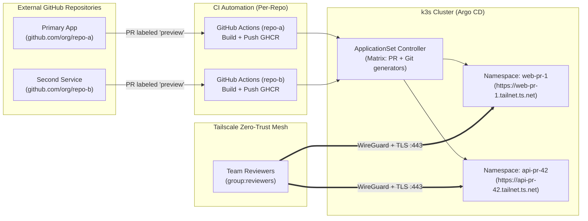

# Team & Multi-Repository Onboarding Guide

> A complete operational runbook for onboarding teammates and integrating new application repositories (public or private) into the **PR Preview Platform** per SPEC v2.0 §6.10.

---

## 1. Overview & Architecture

The PR Preview Platform is designed to be **repository-agnostic** and **team-ready**. By default, it manages previews for the primary demo app, but its Helm charts, Argo CD ApplicationSets, and Tailscale Ingress architecture can support:
1. **Single-Repo Migration:** Reconfiguring the entire platform to serve an external team repository.
2. **Multi-Repo Federation:** Hosting preview environments for multiple microservices (e.g. `frontend-app` and `backend-api`) concurrently on the same k3s cluster.



---

## 2. Prerequisites

Before onboarding a new repository or teammate, ensure:
- [x] Cluster administrator access to the k3s host machine via SSH / `kubectl`.
- [x] Owner or Admin permissions on the target GitHub repository.
- [x] Access to the Tailscale Admin Console (`login.tailscale.com/admin`).

---

## 3. Step 1: GitHub Repository Configuration

Perform these steps on the new application repository (e.g. `https://github.com/<owner>/<new-repo>`):

### 1.1 Create the Preview Label
The GitOps engine filters pull requests using a trigger label.
1. Navigate to: `https://github.com/<owner>/<new-repo>/labels`.
2. Click **New label**.
3. Set **Name:** `preview`.
4. Set **Color:** `#0E8A16` (green) or any preferred color.
5. Click **Create label**.

### 1.2 Configure GitHub Actions Permissions
Workflows must be authorized to leave deployment comments on pull requests and manage GitHub Environments.
1. Navigate to: `Settings` → `Actions` → `General`.
2. Under **Workflow permissions**, select **Read and write permissions**.
3. Check **Allow GitHub Actions to create and approve pull requests**.
4. Click **Save**.

### 1.3 Container Registry Visibility (GHCR)
GitHub Container Registry packages are **private** by default.
- **Recommended (Public Previews):**
  After the first image push, navigate to `https://github.com/users/<owner>/packages/container/package/<app-name>/settings` and scroll down to **Danger Zone** → **Change package visibility** → Set to **Public**.
  *Why:* Enables Kubernetes nodes to pull preview images anonymously without injecting image pull secrets into ephemeral namespaces.
- **Alternative (Private Package):** If code or images must remain strictly private, follow [Section 5.3](#53-private-container-registry-imagepullsecret) to inject image pull secrets.

---

## 4. Step 2: CI Workflow Templates

Add the following two workflow files to `.github/workflows/` in the new repository.

### 4.1 `.github/workflows/preview.yml`
Handles building container images, scanning vulnerabilities with Trivy, pushing to GHCR with standard tags (`pr-<N>-<sha7>` and `pr-<N>-<sha8>`), and posting private preview links.

```yaml
---
name: Preview Build & Push

"on":
  pull_request:
    types:
      - opened
      - synchronize
      - reopened
      - labeled

concurrency:
  group: preview-${{ github.event.pull_request.number }}
  cancel-in-progress: true

permissions:
  contents: read
  packages: write
  pull-requests: write
  deployments: write

env:
  # Set your Tailnet MagicDNS suffix (e.g. example.ts.net)
  TAILNET_NAME: taildc1471.ts.net
  # Container port exposed by your application
  APP_PORT: 8000
  # Health check probe path
  APP_HEALTHCHECK: /healthz
  # Namespace prefix (must match values.yaml namespace.prefix)
  NS_PREFIX: preview

jobs:
  build-preview:
    name: Build, Scan & Push PR Preview Image
    if: >-
      contains(github.event.pull_request.labels.*.name, 'preview') &&
      github.event.pull_request.head.repo.full_name == github.repository
    runs-on: ubuntu-latest
    timeout-minutes: 15

    steps:
      - name: Checkout PR head
        uses: actions/checkout@v4
        with:
          ref: ${{ github.event.pull_request.head.sha }}

      - name: Set Image Name and Tag
        run: |
          PR_NUMBER="${{ github.event.pull_request.number }}"
          SHORT_SHA_7=$(echo "${{ github.event.pull_request.head.sha }}" | cut -c1-7)
          SHORT_SHA_8=$(echo "${{ github.event.pull_request.head.sha }}" | cut -c1-8)
          IMAGE_NAME="ghcr.io/${{ github.repository_owner }}/${{ github.event.repository.name }}"

          echo "PR_NUMBER=${PR_NUMBER}" >> "$GITHUB_ENV"
          echo "SHORT_SHA_7=${SHORT_SHA_7}" >> "$GITHUB_ENV"
          echo "SHORT_SHA_8=${SHORT_SHA_8}" >> "$GITHUB_ENV"
          echo "IMAGE_NAME=${IMAGE_NAME,,}" >> "$GITHUB_ENV"

      - name: Set up Docker Buildx
        uses: docker/setup-buildx-action@v3

      - name: Log in to GitHub Container Registry
        uses: docker/login-action@v3
        with:
          registry: ghcr.io
          username: ${{ github.actor }}
          password: ${{ secrets.GITHUB_TOKEN }}

      - name: Build container image locally
        uses: docker/build-push-action@v6
        with:
          context: .
          load: true
          tags: |
            ${{ env.IMAGE_NAME }}:${{ env.NS_PREFIX }}-${{ env.PR_NUMBER }}-${{ env.SHORT_SHA_7 }}
            ${{ env.IMAGE_NAME }}:${{ env.NS_PREFIX }}-${{ env.PR_NUMBER }}-${{ env.SHORT_SHA_8 }}

      - name: Scan Image with Trivy
        uses: aquasecurity/trivy-action@0.30.0
        with:
          image-ref: ${{ env.IMAGE_NAME }}:${{ env.NS_PREFIX }}-${{ env.PR_NUMBER }}-${{ env.SHORT_SHA_7 }}
          format: table
          exit-code: 1
          severity: HIGH,CRITICAL

      - name: Push Container Images to GHCR
        run: |
          docker push "${{ env.IMAGE_NAME }}:${{ env.NS_PREFIX }}-${{ env.PR_NUMBER }}-${{ env.SHORT_SHA_7 }}"
          docker push "${{ env.IMAGE_NAME }}:${{ env.NS_PREFIX }}-${{ env.PR_NUMBER }}-${{ env.SHORT_SHA_8 }}"

      - name: Post or Update PR Preview Link Comment
        uses: actions/github-script@v7
        with:
          github-token: ${{ secrets.GITHUB_TOKEN }}
          script: |
            const prNumber = context.payload.pull_request.number;
            const prefix = process.env.NS_PREFIX;
            const tailnet = process.env.TAILNET_NAME;
            const previewUrl = `https://${prefix}-${prNumber}.${tailnet}`;
            const header = `### 🚀 PR Preview Environment Available`;

            const body = `${header}\n\n` +
              `| Property | Value |\n` +
              `|---|---|\n` +
              `| **Preview URL** | [${previewUrl}](${previewUrl}) |\n` +
              `| **Commit SHA** | \`${process.env.SHORT_SHA_7}\` |\n` +
              `| **Access** | Private Tailnet (\`group:reviewers\`) |\n\n` +
              `_This environment will be automatically destroyed when the PR is closed or merged._`;

            const { data: comments } = await github.rest.issues.listComments({
              owner: context.repo.owner,
              repo: context.repo.repo,
              issue_number: prNumber,
            });

            const botComment = comments.find(c => c.body && c.body.includes(header));
            if (botComment) {
              await github.rest.issues.updateComment({
                owner: context.repo.owner,
                repo: context.repo.repo,
                comment_id: botComment.id,
                body: body
              });
            } else {
              await github.rest.issues.createComment({
                owner: context.repo.owner,
                repo: context.repo.repo,
                issue_number: prNumber,
                body: body
              });
            }
```

### 4.2 `.github/workflows/preview-closed.yml`
Handles automated garbage collection of container image tags from GHCR upon PR closure.

```yaml
---
name: Preview Cleanup

"on":
  pull_request:
    types:
      - closed

jobs:
  cleanup-preview:
    name: Cleanup Preview GHCR Tags
    runs-on: ubuntu-latest
    timeout-minutes: 10
    permissions:
      packages: write
      pull-requests: write

    steps:
      - name: Delete PR Tags from GHCR
        uses: actions/github-script@v7
        with:
          github-token: ${{ secrets.GITHUB_TOKEN }}
          script: |
            const prNumber = context.payload.pull_request.number;
            const prefix = "preview";
            const tagPrefix = `${prefix}-${prNumber}-`;
            const pkgName = context.repo.repo.toLowerCase();
            const owner = context.repo.owner;

            try {
              const { data: versions } = await github.rest.packages.getAllPackageVersionsForPackageOwnedByUser({
                package_type: 'container',
                package_name: pkgName,
                username: owner,
              });

              for (const ver of versions) {
                const tags = ver.metadata?.container?.tags || [];
                const matches = tags.some(t => t.startsWith(tagPrefix));
                if (matches) {
                  await github.rest.packages.deletePackageVersionForUser({
                    package_type: 'container',
                    package_name: pkgName,
                    username: owner,
                    package_version_id: ver.id,
                  });
                  console.log(`Deleted package version ${ver.id} with tags: ${tags.join(', ')}`);
                }
              }
            } catch (err) {
              console.log(`Note: Package cleanup skipped or failed: ${err.message}`);
            }
```

---

## 5. Step 3: Platform Integration

Depending on your requirements, choose **Option A** (Switch platform target repo) or **Option B** (Multi-repo parallel hosting):

### Option A: Reconfiguring the Platform for a New Target Repo
If the platform is dedicated to one primary team application at a time:
1. Run the interactive onboarding wizard:
   ```bash
   make init
   ```
2. Enter the new repository URL, application name, port, health check path, and prefix.
3. Verify that manifests synchronize cleanly:
   ```bash
   make sync-config
   make doctor ARGS="--only config"
   ```
4. Commit and push the updated `values.yaml` and platform manifests.

### Option B: Hosting Multiple Repositories Concurrently
If the platform hosts previews for multiple microservices simultaneously (e.g. `frontend-app` and `backend-app`):

1. **Update `AppProject` Whitelist (`platform/argocd/project-previews.yaml`):**
   Add the new repository to `spec.sourceRepos`:
   ```yaml
   spec:
     sourceRepos:
       - "https://github.com/Dungx2409/pr-preview-platform.git"
       - "https://github.com/<owner>/<second-repo>.git"
   ```

2. **Add a Dedicated ApplicationSet Manifest (`platform/argocd/applicationset-<second-app>.yaml`):**
   Create a separate ApplicationSet pointing to the second repository with a distinct `namespace.prefix` (e.g. `api` vs `web`) to avoid hostname and namespace collisions:
   ```yaml
   apiVersion: argoproj.io/v1alpha1
   kind: ApplicationSet
   metadata:
     name: previews-<second-app>
     namespace: argocd
   spec:
     goTemplate: true
     generators:
       - matrix:
           generators:
             - pullRequest:
                 github:
                   owner: <owner>
                   repo: <second-repo>
                   labels: ["preview"]
                   tokenRef:
                     secretName: github-token
                     key: token
                 requeueAfterSeconds: 30
             - git:
                 repoURL: https://github.com/Dungx2409/pr-preview-platform.git
                 revision: HEAD
                 files:
                   - path: "values.yaml"
     template:
       metadata:
         name: 'api-{{ .number }}'
       spec:
         project: previews
         source:
           repoURL: 'https://github.com/<owner>/<second-repo>.git'
           targetRevision: '{{ .head_sha }}'
           path: charts/app # or your Helm chart location
           helm:
             valuesObject:
               env: 'api-{{ .number }}'
               ingress:
                 className: tailscale
                 hostname: 'api-{{ .number }}'
               namespace:
                 create: true
                 name: 'api-{{ .number }}'
         destination:
           server: https://kubernetes.default.svc
           namespace: 'api-{{ .number }}'
   ```

3. **Apply the new manifest:**
   ```bash
   kubectl apply -f platform/argocd/project-previews.yaml
   kubectl apply -f platform/argocd/applicationset-<second-app>.yaml
   ```

---

### 5.3 Handling Private Repositories & Private GHCR

#### 1. Argo CD Access to Private Git Repository
If the second repo is **private**, Argo CD must be granted read access:
```bash
# Generate a GitHub Personal Access Token (PAT) with 'repo' (read) scope
kubectl create secret generic repo-second-app-creds \
  --namespace argocd \
  --from-literal=type=git \
  --from-literal=url=https://github.com/<owner>/<second-repo>.git \
  --from-literal=password=<GITHUB_PAT>

kubectl label secret repo-second-app-creds -n argocd \
  "argocd.argoproj.io/secret-type=repository"
```

#### 2. Kubernetes Node Access to Private GHCR (`imagePullSecret`)
If container packages in GHCR are kept private:
1. Create a GitHub Personal Access Token (PAT) with `read:packages` scope.
2. Store the docker credentials secret template:
   ```bash
   kubectl create secret docker-registry ghcr-pull-secret \
     --docker-server=ghcr.io \
     --docker-username=<github-username> \
     --docker-password=<github-pat-with-read-packages> \
     --dry-run=client -o yaml > /tmp/ghcr-secret.yaml
   ```
3. Update `charts/app/values.yaml` to include:
   ```yaml
   imagePullSecrets:
     - name: ghcr-pull-secret
   ```

---

## 6. Step 4: Teammate & Reviewer Access (Tailnet Onboarding)

All preview environments are protected by **Tailscale Zero-Trust ACLs**. Teammates must join the tailnet and be assigned to the authorized reviewers group.

### 6.1 Tailscale Free Tier User Limits & Strategies
> [!IMPORTANT]
> Official Tailscale Personal (Free) plan limits:
> - **3 users** (identities) max.
> - **100 connected devices** max.
> - **50 tagged resources** max.
> - **3 ACL groups** max.

For a student team of **4–5 people**, choose one of the following approaches:

| Strategy | Capacity | Cost | Best For |
|---|---|---|---|
| **Approach 1: Node Sharing (`tailscale share`)** *(Recommended)* | Unlimited reviewers | **$0 (Free)** | Student teams / Hackathons where teammates each have their own free Tailscale accounts. |
| **Approach 2: GitHub Organization Tailnet** | Free for Public Orgs | **$0 (Free)** | Open-source student teams sharing a GitHub Organization identity. |
| **Approach 3: Tailscale Starter Plan** | Unlimited seats | $6 / user / mo | Professional production teams needing centralized user lifecycle management. |

#### Using Approach 1: Node Sharing (No User Limit)
1. Go to **Tailscale Admin Console** → **Machines**.
2. Find the Tailscale Ingress Proxy device corresponding to the preview or shared environment (e.g. `shared`, `preview-pr-1`).
3. Click the **...** menu on the right → **Share...**
4. Enter teammate's email address and generate a share invite link.
5. Teammate accepts in their own free Tailscale account. The HTTPS URL resolves and connects directly through WireGuard without using up seats in your tailnet!

---

### 6.2 Adding Teammates to `group:reviewers`
If teammates are invited directly into your primary tailnet:
1. Navigate to: `https://login.tailscale.com/admin/users`.
2. Click **Invite users** and enter teammate email addresses.
3. Navigate to: `https://login.tailscale.com/admin/acls`.
4. Edit your Tailscale Access Control Policy to include teammate emails in `group:reviewers`:

```json
{
  "tagOwners": {
    "tag:k8s-operator": ["autogroup:admin"],
    "tag:k8s": ["tag:k8s-operator"]
  },
  "groups": {
    "group:reviewers": [
      "autogroup:admin",
      "alice@gmail.com",
      "bob@gmail.com",
      "charlie@gmail.com"
    ]
  },
  "acls": [
    {
      "action": "accept",
      "src": ["group:reviewers"],
      "dst": ["tag:k8s:443"]
    }
  ]
}
```
5. Click **Save**. ACL rules apply instantly across the WireGuard mesh.

---

### 6.3 Teammate Workstation Setup
Instruct each teammate to execute:
1. Install Tailscale:
   - macOS / Windows: Download from `https://tailscale.com/download`.
   - Linux: `curl -fsSL https://tailscale.com/install.sh | sh`
   - Mobile: Tailscale app from App Store / Google Play.
2. Authenticate to the tailnet:
   ```bash
   sudo tailscale up --accept-routes
   ```
3. Confirm connection:
   ```bash
   tailscale status
   ```

---

## 7. Step 5: Verification & End-to-End Acceptance

Verify the entire onboarding lifecycle with these checks:

### 7.1 Lifecycle Verification Checklist
- [ ] **Trigger:** Open a test Pull Request on the newly onboarded repo and apply the `preview` label.
- [ ] **CI Execution:** Verify `preview.yml` builds, scans with Trivy, pushes to GHCR, and comments on the PR with the preview URL: `https://<prefix>-<N>.<tailnet>.ts.net`.
- [ ] **GitOps Sync:** Verify Argo CD creates Application `preview-<prefix>-<N>` in namespace `argocd` and reports `Synced / Healthy`.
- [ ] **Ingress TLS:** Verify the Tailscale Operator provisions proxy pod `ts-<prefix>-<N>-*` and registers the device in the Tailscale admin console.

### 7.2 Access Control Verification (Positive & Negative Tests)
Execute from teammate workstations:

```bash
# 1. Positive Test: Authorized Reviewer (inside group:reviewers)
curl -Iv https://<prefix>-<N>.<tailnet>.ts.net/healthz
# Expected Result:
# HTTP/2 200 OK
# SSL certificate verify ok (Let's Encrypt Authority)

# 2. Negative Test: Device outside tailnet or user outside group:reviewers
curl -Iv --connect-timeout 5 https://<prefix>-<N>.<tailnet>.ts.net/healthz
# Expected Result:
# Could not resolve host (NXDOMAIN) OR Connection timed out (ACL Drop)
```

### 7.3 Teardown Verification
- [ ] Close the test PR.
- [ ] Verify `preview-closed.yml` executes and deletes remote GHCR tags.
- [ ] Verify Argo CD cascade-deletes namespace `<prefix>-<N>`, removing deployments, pods, and the Tailscale proxy device.
- [ ] Run `make verify-teardown` on the host to confirm **0 leaked resources**.
