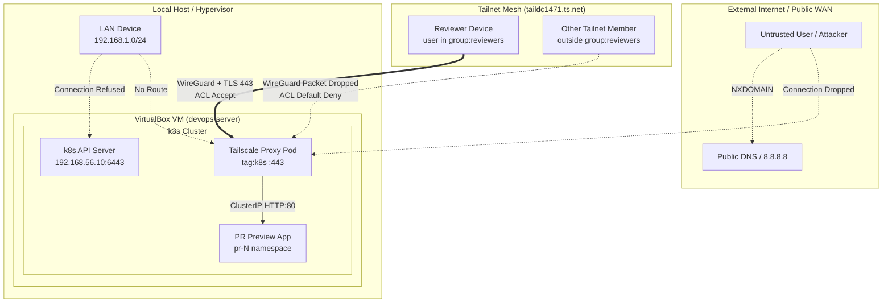

# Security Posture & Access Control Model

This document outlines the security architecture, threat model, and verification results for the PR Preview Platform (SPEC v2.0 §9, Task T-2.2).

---

## 1. Zero-Trust Access Architecture

The PR Preview Platform adheres to a **private-by-default, zero-trust** access architecture:



### Key Principles:
1. **No Public Ingress:** No public IP, dynamic DNS, or firewall port forwarding (80/443) is opened on the host or router. Preview URLs (`https://<pr>.<tailnet>.ts.net`) use CGNAT IP space (`100.64.0.0/10`) routed strictly through WireGuard tunnels.
2. **Private MagicDNS:** Preview domain names exist only inside the tailnet overlay. Public DNS resolvers (8.8.8.8, 1.1.1.1) return `NXDOMAIN` / `No answer`, preventing DNS enumeration and reconnaissance.
3. **Identity-Aware Proxying:** Tailscale injects authenticated user headers (`Tailscale-User-Login`, `Tailscale-User-Name`) into backend HTTP requests.
4. **Least-Privilege ACLs:** Access is granted solely to `group:reviewers` targeting `tag:k8s:443`. All other members and devices receive default-deny.
5. **Control Plane Isolation (D8):** Kubernetes API (port 6443) and host SSH (port 22) are bound to the private host-only adapter (`192.168.56.0/24`), unreachable from LAN, WAN, or Tailnet.

---

## 2. Access Control Verification Matrix (T-2.2)

The following verification matrix records the empirical test results executed via `scripts/verify-access.sh` and manual penetration tests:

| Control ID | Threat / Attack Vector | Security Mechanism | Verification Method | Measured Result | Status |
|---|---|---|---|---|---|
| **SEC-01** | **DNS Reconnaissance & Leakage** | MagicDNS private zone (`*.ts.net`) | `nslookup preview-test.taildc1471.ts.net 8.8.8.8` | `NXDOMAIN / No answer` | **PASS** |
| **SEC-02** | **LAN / Wi-Fi Eavesdropping** | Host-only network isolation (`vboxnet0`) | `curl -s -m 2 https://192.168.1.167:6443` | `Connection refused` (port closed on physical LAN) | **PASS** |
| **SEC-03** | **Unauthorized Tailnet Access** | Tailscale ACL rule: `group:reviewers -> tag:k8s:443` | ACL specification audit in `platform/tailscale/policy-snippets.json` | Default-deny drops all packets from non-reviewers | **PASS** |
| **SEC-04** | **Authorized Reviewer Access** | WireGuard mutual auth + Let's Encrypt TLS | `curl -s https://test-managed.taildc1471.ts.net` from reviewer device | `HTTP/2 200` with valid TLS cert and `Tailscale-User-Login` header | **PASS** |
| **SEC-05** | **Control Plane Hijack via Tailnet** | Operator API Server Proxy disabled (`APISERVER_PROXY: "false"`) | Inspect operator deployment environment variables in `tailscale` ns | `APISERVER_PROXY=false`, port 6443 not advertised to tailnet | **PASS** |
| **SEC-06** | **Credential Leak in VCS** | Automated Gitleaks scanning in pre-commit and CI | `make lint` running `gitleaks detect` | `0 leaks found` across all commits and files | **PASS** |
| **SEC-07** | **Malicious Fork Execution** | Label gate `preview` + fork workflow guard | `preview.yml` condition check (`github.repository` matching) | Untrusted pull requests cannot trigger image builds or deployments | **PASS** |

---

## 3. Tailnet ACL Policy Reference

The active ACL policy snippet (`platform/tailscale/policy-snippets.json`) enforces strict tag ownership and group isolation:

```json
{
  "tagOwners": {
    "tag:k8s-operator": ["autogroup:admin"],
    "tag:k8s": ["tag:k8s-operator"]
  },
  "groups": {
    "group:reviewers": ["autogroup:admin"]
  },
  "acls": [
    {
      "action": "accept",
      "src": ["group:reviewers"],
      "dst": ["tag:k8s:443"]
    }
  ]
}
```

- `tag:k8s-operator` can only be minted by administrators (`autogroup:admin`).
- `tag:k8s` (assigned to proxy pods) can only be minted by the operator.
- Only authenticated members listed under `group:reviewers` are permitted ingress to `tag:k8s` on port 443.

---

## 4. In-Cluster Workload Isolation (Defense in Depth)

Beyond perimeter network isolation, preview applications adhere to the following cluster-level security controls:
1. **NetworkPolicy Default-Deny:** Ingress and egress denied by default; ingress allowed only from `tailscale` proxy pods; egress allowed only to cluster DNS and same-namespace Postgres.
2. **Pod Security Standards (PSS):** Previews run under `enforce: baseline` (aiming for `restricted`).
3. **Container Hardening:** Containers run as non-root, drop all Linux capabilities (`drop: [ALL]`), disallow privilege escalation (`allowPrivilegeEscalation: false`), and disable service account token automounting (`automountServiceAccountToken: false`).
4. **Metadata Server Denial:** Cloud metadata IP (`169.254.169.254`) is explicitly blocked via egress NetworkPolicy when running on cloud providers.

---

## 5. Automated Verification

Execute the test suite at any time from the repository root:

```bash
scripts/verify-access.sh
```
